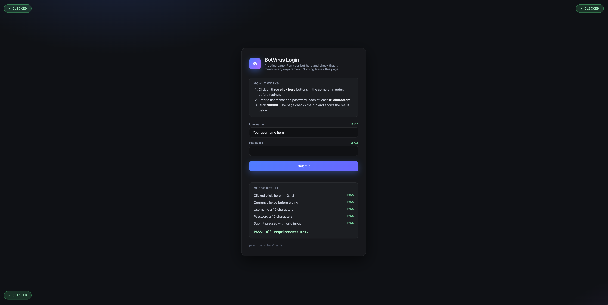

# Practice Page

A local copy of the challenge page, so you can run your bot and check it meets the requirements before submitting.

It has the same layout, element ids and form rules as the challenge page. It does not contain any scoring, reporting or network code.

The screenshot shows a passing run: all three corners clicked, both fields at 16+ characters, and Submit pressed.

## Run

Open `index.html` in a browser, or run `open practice/index.html` from `examples/miner_commit`.

Your bot should target these ids:

| Id | Element |
| --- | --- |
| `click-here-1`, `click-here-2`, `click-here-3` | Corner buttons |
| `username` | Text input, at least 16 characters |
| `password` | Password input, at least 16 characters |
| `submit` | Submit button |

## What is checked

Pressing **Submit** always runs the checks. The result panel shows PASS or FAIL for each item and sets `data-status` on `#check-result` (`pass`, `fail`, or `pending` before submit), so your bot can read it.

1. **Corners clicked**: all of `click-here-1`, `click-here-2` and `click-here-3` were clicked.
2. **Order**: all three corners were clicked before the first keystroke in either field. Typing before the corners fails this check.
3. **Username**: at least 16 characters.
4. **Password**: at least 16 characters.
5. **Submit**: all of the above held at the time of submit.

## Notes

- The page keeps the run state in memory only. It does not send, store or log anything.
- This checks the page's behaviour, not your code. Run the Ruff and Dockerfile checks in the main `README.md` as well.
